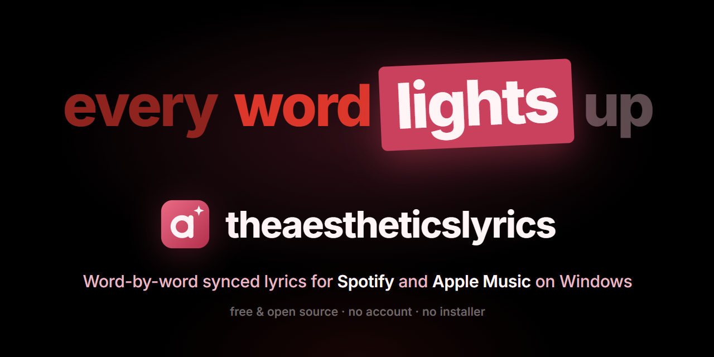
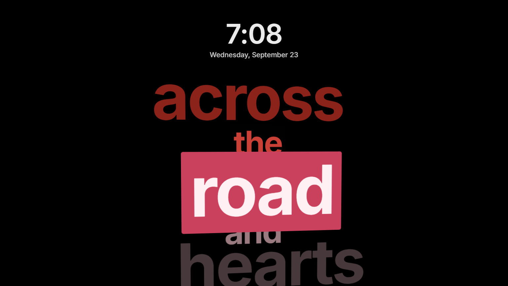
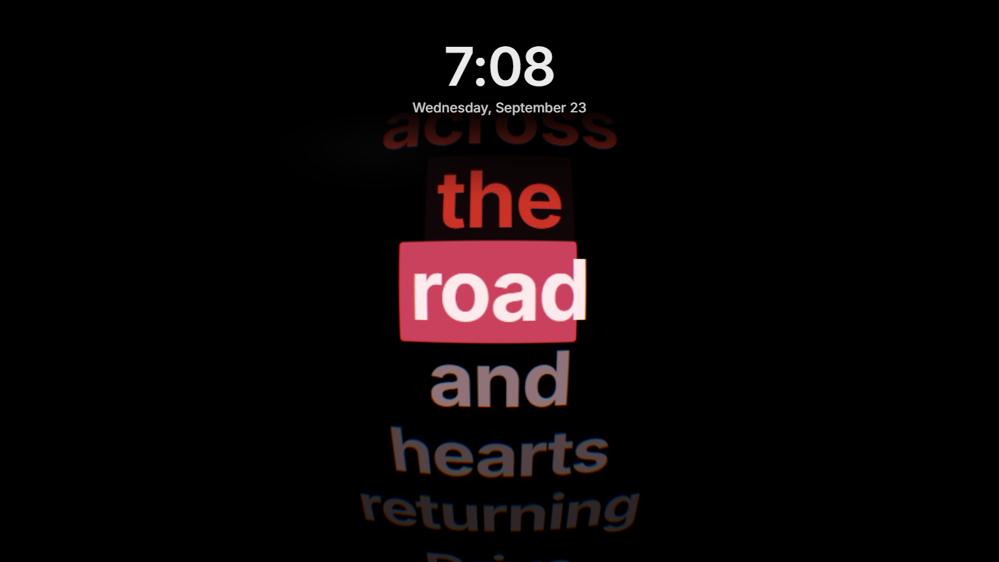
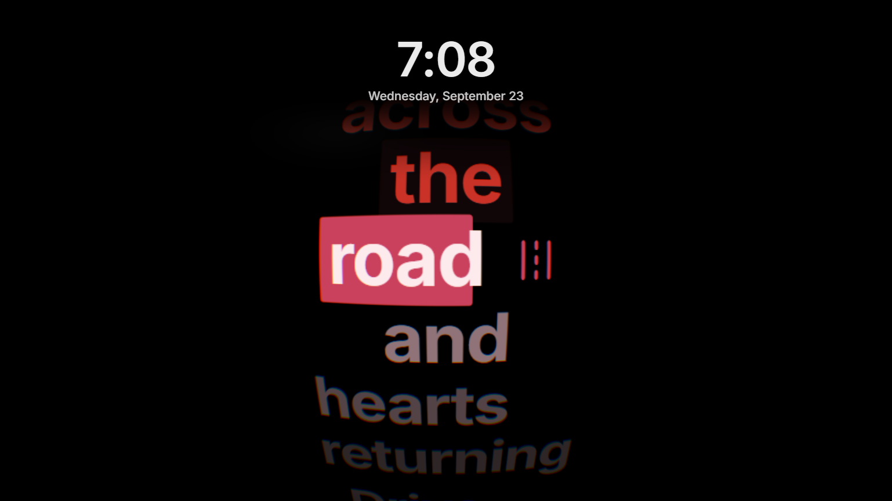
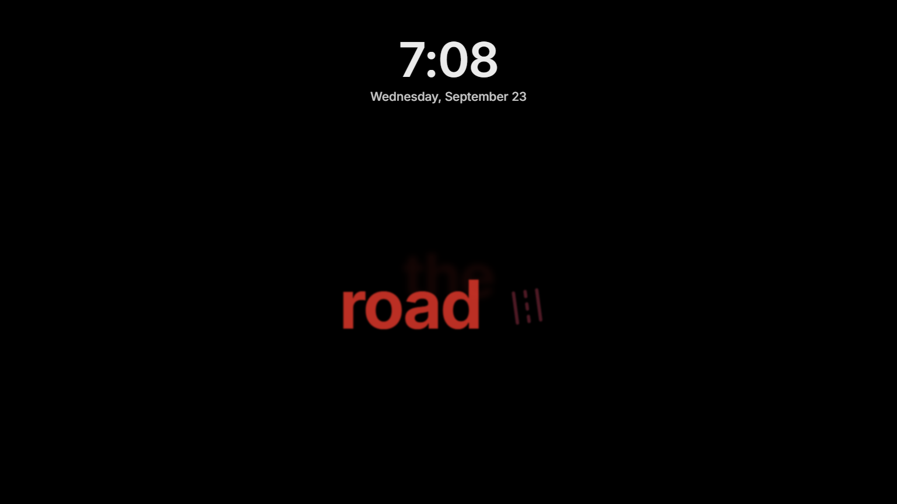

<p align="center">
  
</p>

<p align="center">
  <a href="https://github.com/darshanseenivasakumar/theaestheticslyrics/releases/latest"></a>
  <a href="https://github.com/darshanseenivasakumar/theaestheticslyrics/actions/workflows/ci.yml"></a>
  
  <a href="LICENSE"></a>
</p>

**theaestheticslyrics** lights up the lyrics of the song you're playing one word at a time, right as each word is sung. It sits in the Windows system tray and follows Spotify or Apple Music. The lyrics show on a full-screen lyrics screen when you step away, or float over your desktop while you work.

It's a Windows take on [Verci](https://verci.xyz), a Mac app. It's free and open source, and you don't need an account or an API key.

## Download

1. Download **`theaestheticslyrics-1.0.0-win-x64.zip`** from the [latest release](https://github.com/darshanseenivasakumar/theaestheticslyrics/releases/latest). It needs Windows 10 or 11, 64-bit.
2. Unzip it anywhere, for example into `Documents\theaestheticslyrics`.
3. Run **`theaestheticslyrics.exe`**. There's nothing to install. To uninstall, delete the folder.

> [!NOTE]
> The app isn't code-signed, so Windows SmartScreen may say *"Windows protected your PC"* the first time. Click **More info → Run anyway**. Every release is built from the source in this repository, and you can build it yourself (see [Build from source](#build-from-source)).

**Tip:** to put an icon on your desktop, right-click `theaestheticslyrics.exe`, then **Show more options → Send to → Desktop (create shortcut)**. Opening that icon while the app is already running shows the lyrics right away.

## Four styles

| Ship | Fisheye |
|:---:|:---:|
|  |  |
| Words stack into a wall that drifts in 3D. The word being sung pops forward on a highlight box. | A convex stack of words under a real glass-lens shader. The word being sung sits closest to the glass. |
| **Fisheye Visual** | **Visual** |
|  |  |
| The same lens, with icons beside the words. | One word at a time, with a matching icon or emoji beside it. About 800 words have one. |

*The screenshots use an original demo song written for this project.*

## How to use it

1. Play a song in **Spotify** or **Apple Music**.
2. Press **Ctrl+Alt+L**. The lyrics fill the screen. Press **Esc** to close them.
3. Every setting is in the tray icon (the pink **a**). On Windows 11 it may be hidden under the **^** arrow; drag it onto the taskbar to keep it visible.

### Where the lyrics show

Pick one in tray → **Show Lyrics**.

- **On the Lock Screen** (the default). Windows doesn't let apps draw on the real lock screen, so the app has its own full-screen lyrics screen with a clock.
  - **Ctrl+Alt+L** opens it. It stays up while you move the mouse or skip songs. **Esc** closes it, and so does pressing **Ctrl+Alt+L** again.
  - **When you're away:** after 2 minutes without input, while a song with lyrics is playing, the lyrics screen opens on its own and closes when you come back. Change the delay or turn it off in tray → **Lyrics Screen When Idle**.
  - **Lock Windows When I Come Back** (off by default) turns Ctrl+Alt+L into "lock my PC with lyrics". Any key or mouse move then closes the lyrics and locks Windows, so your PIN or password is needed.
- **Always.** The words float above everything. Clicks go straight through them, and they hide 3 seconds after you pause.

### Colours

- The default palette is red for sung words, a pink highlight and soft pink for words still to come.
- **Auto Sync** takes the colours from the album art and keeps them readable on black.
- **Lyric Text…**, **Highlight…** and **Secondary Text…** let you pick your own colours. **Reset Colors** goes back to the defaults.

### Everything else in the tray

| Setting | What it does |
|---|---|
| **Display** | Picks the monitor the lyrics appear on. |
| **Style** | Ship, Fisheye, Fisheye Visual or Visual. |
| **Timing** | Shifts the words earlier or later. Bluetooth headphones usually need *0.25–0.5 s Later*. |
| **Precise Word Timing (NetEase)** | Uses real per-word timing when NetEase has the song (see below). |
| **Players** | *Spotify and Apple Music*, or *All Media Apps* (browsers, YouTube Music and anything else that shows in Windows' media controls). |
| **Open Lyrics Folder** | Opens the folder for your own `.lrc` files. |
| **Start with Windows** | Starts the app quietly in the tray when you sign in. |

While a song with lyrics plays, your display stays awake. When the music stops, Windows' normal sleep and lock timers take over again.

## Where the lyrics come from

Two free sources are asked at the same time:

- **[LRCLIB](https://lrclib.net)**, an open, community-run lyrics database. It has exact *line* timing for a huge number of songs. Inside each line, the app estimates when each word is sung from its syllables, punctuation and the song's pace. Every line re-syncs to the real time, so small errors never add up.
- **NetEase Cloud Music**, through its public but undocumented web API. For many songs it has real *per-word* timing, so every word lights exactly when it's sung. You can turn it off in the tray.

Your own lyrics come first. Put `.lrc` files in **Documents\theaestheticslyrics\Lyrics** (tray → **Open Lyrics Folder**), named `Artist - Title.lrc`. Enhanced LRC with `<mm:ss.xx>` word tags is used exactly as written.

Lyrics you've played before load instantly from a local cache. Songs with no synced lyrics show nothing, and the tray tells you so.

## Privacy

- To look lyrics up, the app sends only the song's **title, artist, album and length** to `lrclib.net` and, if precise word timing is on, to `music.163.com`.
- It has no accounts, analytics, telemetry or ads.
- Everything else stays on your PC:
  - settings, lyrics cache and log in `%APPDATA%\theaestheticslyrics`
  - your own lyrics in `Documents\theaestheticslyrics\Lyrics`

## Troubleshooting

| Problem | Fix |
|---|---|
| The first launch takes a few seconds | Windows scans a newly downloaded app once. The lyrics screen appears as soon as the scan finishes, and later launches are instant. |
| The tray says *Cannot read what is playing* | The app reads Windows' media controls through Windows PowerShell 5.1, which comes with Windows. Check that `C:\Windows\System32\WindowsPowerShell\v1.0\powershell.exe` exists and isn't blocked by a policy. The log (below) has the details. |
| *No synced lyrics for …* | Neither source has timed lyrics for that song. Add your own `.lrc` file. |
| Words light up a little early or late | Use tray → **Timing**. Bluetooth audio usually runs 0.25–0.5 s behind. |
| Ctrl+Alt+L does nothing | Another app already uses that shortcut, and the tray then shows no shortcut next to the lyrics-screen item. Use the tray item instead. |
| Touching anything after Ctrl+Alt+L shows the Windows sign-in screen | **Lock Windows When I Come Back** is on. Turn it off in the tray. |
| **Start with Windows** is greyed out | It only works in the released app, not when running from source. If you move the app folder, turn it off and on again. |

- **Log:** `%APPDATA%\theaestheticslyrics\logs\theaestheticslyrics.log`
- **Settings:** `%APPDATA%\theaestheticslyrics\settings.json`

## Build from source

You need Windows 10 or 11 and [Node.js](https://nodejs.org) 22.12 or newer (24 LTS recommended).

```powershell
git clone https://github.com/darshanseenivasakumar/theaestheticslyrics.git
cd theaestheticslyrics
npm ci
npm run dev
```

The first run downloads Electron.

| Command | What it does |
|---|---|
| `npm run dev` | Runs the app with hot reload. |
| `npm test` | Runs the unit tests (Vitest). |
| `npm run typecheck` | Runs strict TypeScript for the main process and the pages. |
| `npm run package` | Builds the portable folder and zip into `release\`. |
| `npm run snapshot` | Renders every style offscreen into `snapshots\*.png`. |
| `npm run fake-player` | Starts a silent test "player" that shows up in Windows' media controls. |
| `npm run check:lrclib` | Runs a live check against lrclib.net that prints metadata only. |
| `npm run icons` | Regenerates the Fluent icon subset and the app icons. |

### Testing without real music

These switches let you test at any hour without touching your real settings:

| Switch | Effect |
|---|---|
| `TAL_PROFILE=<dir>` | Uses a separate folder for settings, cache and log. |
| `TAL_LYRICS_DIR=<dir>` | Uses a different folder for your own lyrics. |
| `TAL_NO_LOCK=1` | Logs instead of really locking Windows. |
| `--open-lock-after=<ms>` | Opens the lyrics screen. |
| `--return-after=<ms>` | Simulates someone coming back. |
| `--capture-after=<ms> --capture-file=<png>` | Saves what the lyrics screen shows. |
| `--capture-colors=<png>` | Saves the Colors window. |
| `--quit-after=<ms>` | Quits on its own. |

Run `npm run fake-player`, then start the app with the switches above. `tests\fixtures` holds an original test song written for this project.

### Project layout

```
src/main/       tray app: media bridge, lyrics sources and cache, palette, windows, power
src/preload/    the only bridge between the sandboxed pages and the app
src/renderer/   the lyrics screen (four styles) and the Colors window
src/shared/     types and the IPC contract used by both sides
resources/      smtc-bridge.ps1 (Windows media sessions → JSON lines) and the icons
docs/           screenshots, plus the original design spec and plan
```

## Contributing

Issues and pull requests are welcome. Please run `npm run typecheck` and `npm test` before opening a pull request.

**Never commit real song lyrics:** tests, fixtures and screenshots use original text only.

## Credits

- Inspired by [Verci](https://verci.xyz) for macOS.
- Lyrics come from [LRCLIB](https://lrclib.net) and NetEase Cloud Music.
- The font is [Inter](https://rsms.me/inter/) (SIL OFL 1.1).
- Icons are [Fluent UI System Icons](https://github.com/microsoft/fluentui-system-icons) (MIT) and Segoe UI Emoji.
- Built with [Electron](https://www.electronjs.org), [electron-vite](https://electron-vite.org) and TypeScript.
- Third-party licenses are in [THIRD_PARTY_NOTICES.md](THIRD_PARTY_NOTICES.md).

theaestheticslyrics is an independent project. It isn't affiliated with or endorsed by Verci, Spotify, Apple, NetEase or LRCLIB. Lyrics belong to their songwriters and publishers, and no lyrics are stored in this repository.

## License

[MIT](LICENSE) © 2026 darshanseenivasakumar
